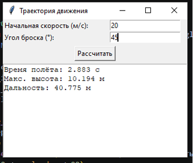

# Лабораторная работа №1 — Порождающие паттерны: Одиночка, Строитель

**Дисциплина:** Паттерны проектирования  
**Направление:** 09.03.04 «Программная инженерия»  
**Индивидуальный вариант:** 3 — Разработка приложения «Траектория движения»  
**Реализованный паттерн:** Одиночка (Singleton)  
**Язык:** Python

## Цель работы

Изучить принцип работы порождающего паттерна проектирования «Одиночка» и реализовать прикладную задачу расчёта траектории движения тела, брошенного под углом к горизонту, с использованием данного паттерна.

## Задача

Реализовать один из порождающих паттернов проектирования — «Строитель» или «Одиночка».

## Описание паттерна «Одиночка»

Паттерн **Singleton** гарантирует, что для класса создаётся только один экземпляр, и предоставляет единую точку доступа к нему.

В приложении паттерн применён к классу `TrajectoryCalculator`, который отвечает за все расчёты. Для реализации используется переменная `_instance` и переопределённый метод `__new__()`. При создании объекта проверяется наличие существующего экземпляра: если его нет — создаётся новый, при последующих обращениях возвращается уже существующий.

## Описание приложения

Приложение рассчитывает параметры движения тела, брошенного под углом к горизонту:

- время полёта;
- максимальная высота подъёма;
- дальность полёта;
- график траектории.

**Стек:** Python, Tkinter (GUI), Matplotlib (график).

**Ограничения на входные данные:**
- начальная скорость > 0;
- угол броска в диапазоне (0; 90) градусов.

## Диаграмма классов

Структура приложения включает два основных класса:
- `TrajectoryApp` — графический интерфейс, обработка действий пользователя, взаимодействие с калькулятором;
- `TrajectoryCalculator` — реализует Singleton и выполняет все расчёты.

Связь между классами: `TrajectoryApp` использует единственный экземпляр `TrajectoryCalculator`.

## Пример работы

Вход: `v0 = 20 м/с`, `угол = 45°`

Вывод: 

*Рисунок — Результаты расчёта для v0 = 20 м/с, угол = 45°*

## Исходный код

См. [`main.py`](./main.py).