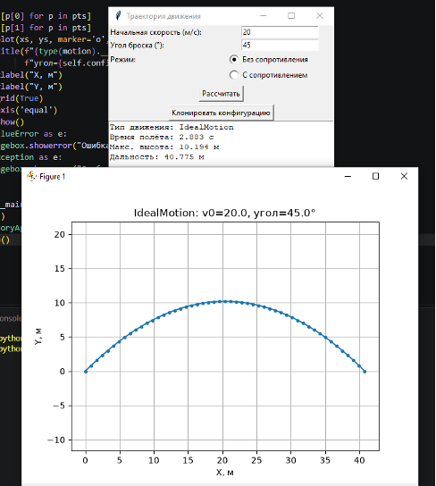
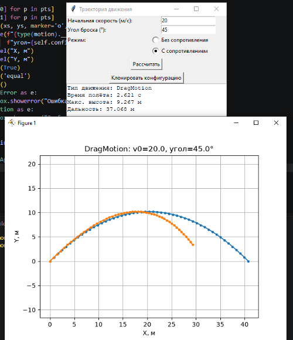

# Лабораторная работа №2 — Порождающие паттерны: Абстрактная фабрика, Фабричный метод, Прототип

**Дисциплина:** Паттерны проектирования  
**Направление:** 09.03.04 «Программная инженерия»  
**Индивидуальный вариант:** 3 — Разработка приложения «Траектория движения»  
**Реализованные паттерны:** Фабричный метод (Factory Method), Прототип (Prototype)  
**Язык:** Python

## Цель работы

Изучить принцип работы порождающих паттернов проектирования «Фабричный метод» и «Прототип» и реализовать прикладную задачу расчёта траектории движения тела с использованием данных паттернов.

## Задача

Разработать приложение для расчёта параметров движения тела, брошенного под углом к горизонту, с использованием двух порождающих паттернов проектирования.

## Описание паттернов

### 1. Фабричный метод (Factory Method)
Паттерн определяет интерфейс для создания объекта, но позволяет подклассам изменять тип создаваемого объекта. 
В задаче создан абстрактный класс `MotionFactory` с методом `create_motion()`. Конкретные фабрики (`IdealMotionFactory`, `DragMotionFactory`) создают соответствующие объекты движений:
- `IdealMotion` — движение без сопротивления воздуха;
- `DragMotion` — движение с учётом сопротивления воздуха.

### 2. Прототип (Prototype)
Паттерн позволяет копировать объекты, не вдаваясь в подробности их реализации. 
Класс `MotionConfig` хранит параметры расчёта (начальная скорость, угол, шаг интегрирования и т.д.) и реализует метод `clone()` (через `copy.deepcopy()`), позволяющий быстро создавать независимые конфигурации.

## Структура приложения

| Компонент | Назначение |
| :--- | :--- |
| `Motion` | Абстрактный класс движения (интерфейс) |
| `IdealMotion` | Движение без сопротивления воздуха |
| `DragMotion` | Движение с сопротивлением воздуха |
| `MotionFactory` | Абстрактная фабрика движений |
| `IdealMotionFactory` | Фабрика идеального движения |
| `DragMotionFactory` | Фабрика движения с сопротивлением |
| `MotionConfig` | Конфигурация расчёта (Прототип) |
| `TrajectoryApp` | Графический интерфейс приложения |

## Пример работы

| Режим «Без сопротивления» | Режим «С сопротивлением» |
| :---: | :---: |
|  |  |
| *Рисунок 1 — Идеальное движение* | *Рисунок 2 — Движение с сопротивлением* |

## Исходный код

См. [`main.py`](./main.py).