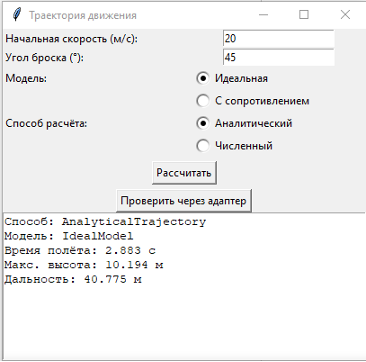
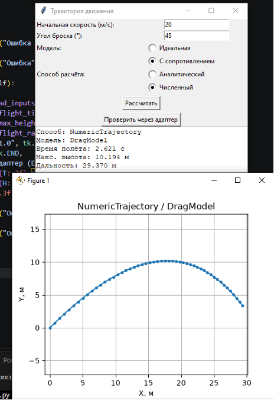
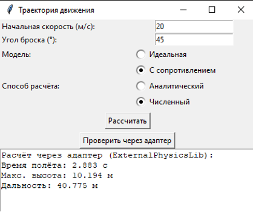

# Лабораторная работа №3 — Структурные паттерны: Адаптер, Мост

**Дисциплина:** Паттерны проектирования  
**Направление:** 09.03.04 «Программная инженерия»  
**Индивидуальный вариант:** 3 — Разработка приложения «Траектория движения»  
**Реализованные паттерны:** Адаптер (Adapter), Мост (Bridge)  
**Язык:** Python

## Цель работы

Изучить принцип работы структурных паттернов проектирования «Адаптер» и «Мост» и реализовать прикладную задачу расчёта траектории движения тела с использованием данных паттернов.

## Задача

Разработать приложение для расчёта параметров движения тела, брошенного под углом к горизонту, с использованием двух структурных паттернов проектирования.

## Описание паттернов

### 1. Адаптер (Adapter)
Паттерн позволяет объектам с несовместимыми интерфейсами работать вместе. Адаптер выступает посредником, преобразуя вызовы одного интерфейса в вызовы другого.

**Применение:** В приложении есть целевой интерфейс `TrajectoryCalculator` с методами `flight_time()`, `max_height()`, `flight_range()`. Сторонняя библиотека `ExternalPhysicsLib` имеет другой интерфейс (принимает угол в радианах, методы называются `calc_time`, `calc_height`, `calc_distance`). Класс `PhysicsLibAdapter` реализует интерфейс `TrajectoryCalculator`, но внутри преобразует градусы в радианы и делегирует вызовы библиотеке.

### 2. Мост (Bridge)
Паттерн разделяет абстракцию и её реализацию так, чтобы они могли изменяться независимо. Вместо жёсткой иерархии наследования используется композиция.

**Применение:** Абстракция `Trajectory` (способ расчёта) отделена от реализации `MotionModel` (физическая модель). Реализованы два способа расчёта (`AnalyticalTrajectory`, `NumericTrajectory`) и две модели движения (`IdealModel`, `DragModel`). Любая комбинация «способ × модель» работает без изменения кода.

## Структура приложения

| Компонент | Назначение |
| :--- | :--- |
| `TrajectoryCalculator` | Интерфейс расчёта (целевой интерфейс для Адаптера) |
| `ExternalPhysicsLib` | Сторонняя библиотека с несовместимым интерфейсом |
| `PhysicsLibAdapter` | Адаптер, приводящий `ExternalPhysicsLib` к `TrajectoryCalculator` |
| `MotionModel` | Реализация модели движения (часть Моста) |
| `IdealModel` | Идеальная модель движения |
| `DragModel` | Модель с сопротивлением воздуха |
| `Trajectory` | Абстракция расчёта траектории (часть Моста) |
| `AnalyticalTrajectory` | Аналитический способ расчёта |
| `NumericTrajectory` | Численный способ расчёта |
| `TrajectoryApp` | Графический интерфейс приложения |

## Примеры работы

Вход: `v0 = 20 м/с`, `угол = 45°`

**Аналитический способ, идеальная модель:**

**Численный способ, модель с сопротивлением:**

**Расчёт через адаптер (ExternalPhysicsLib):**

## Исходный код

См. [`main.py`](./main.py).
