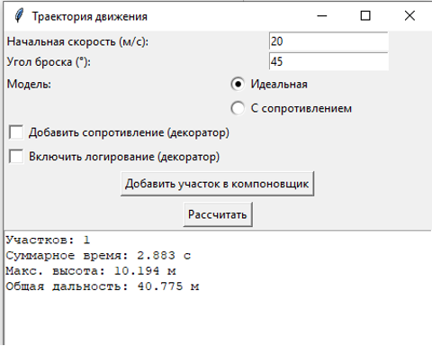
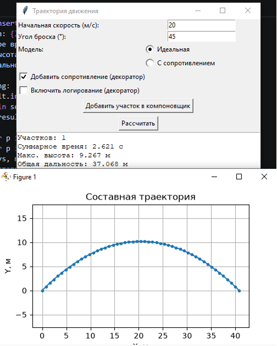
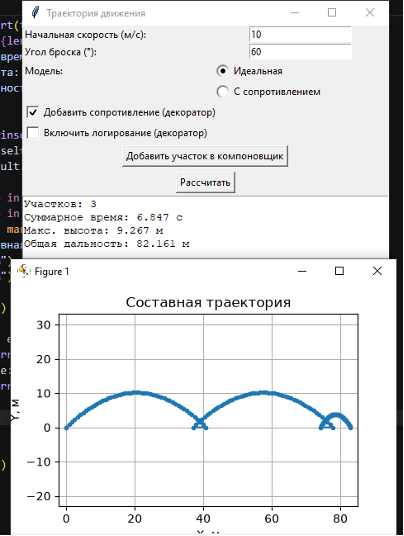
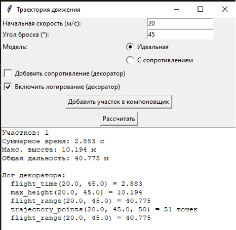

# Лабораторная работа №4 — Структурные паттерны: Компоновщик, Декоратор

**Дисциплина:** Паттерны проектирования  
**Направление:** 09.03.04 «Программная инженерия»  
**Индивидуальный вариант:** 3 — Разработка приложения «Траектория движения»  
**Реализованные паттерны:** Компоновщик (Composite), Декоратор (Decorator)  
**Язык:** Python

## Цель работы

Изучить принцип работы структурных паттернов проектирования «Компоновщик» (Composite) и «Декоратор» (Decorator) и реализовать прикладную задачу расчёта траектории движения тела с использованием данных паттернов.

## Задача

Разработать приложение для расчёта параметров движения тела, брошенного под углом к горизонту, с использованием двух структурных паттернов проектирования.

## Описание паттернов

### 1. Компоновщик (Composite)
Паттерн позволяет объединять объекты в древовидные структуры и работать с ними как с отдельными объектами. Вводит общий интерфейс для «листьев» (простых объектов) и «контейнеров» (составных объектов).

**Применение:** Интерфейс `TrajectoryComponent` задаёт методы `points()`, `total_time()`, `max_height()`, `flight_range()`. Класс `SimpleSegment` — «лист» (один участок с заданной скоростью, углом и моделью). `CompositeTrajectory` — контейнер, хранящий список дочерних компонентов и вычисляющий суммарные параметры (общее время, максимум высоты, суммарная дальность).

### 2. Декоратор (Decorator)
Паттерн позволяет динамически добавлять объекту новое поведение, не изменяя его класс. Декоратор оборачивает объект и делегирует ему вызовы, добавляя свою логику до или после.

**Применение:** Интерфейс `MotionModel` описывает модель движения. Базовые модели — `IdealModel` и `BasicDragModel`. Декораторы `DragDecorator` (добавляет учёт сопротивления воздуха) и `LoggingDecorator` (записывает вызовы в лог) оборачивают любую модель и могут комбинироваться.

## Структура приложения

| Компонент | Назначение |
| :--- | :--- |
| `TrajectoryComponent` | Общий интерфейс для листа и контейнера (Компоновщик) |
| `SimpleSegment` | Лист — один участок траектории |
| `CompositeTrajectory` | Контейнер — объединение нескольких участков |
| `MotionModel` | Базовый интерфейс модели движения (Декоратор) |
| `IdealModel` | Базовая модель без сопротивления |
| `BasicDragModel` | Базовая модель с упрощённым сопротивлением |
| `MotionDecorator` | Абстрактный декоратор |
| `DragDecorator` | Декоратор, добавляющий сопротивление воздуха |
| `LoggingDecorator` | Декоратор, добавляющий логирование расчётов |
| `TrajectoryApp` | Графический интерфейс приложения |

## Примеры работы

Вход: `v0 = 20 м/с`, `угол = 45°`

**Расчёт одного участка (IdealModel):**

**Расчёт с декоратором DragDecorator:**

**Расчёт составной траектории (Компоновщик):**

**Лог расчётов (LoggingDecorator):**

## Исходный код

См. [`main.py`](./main.py).