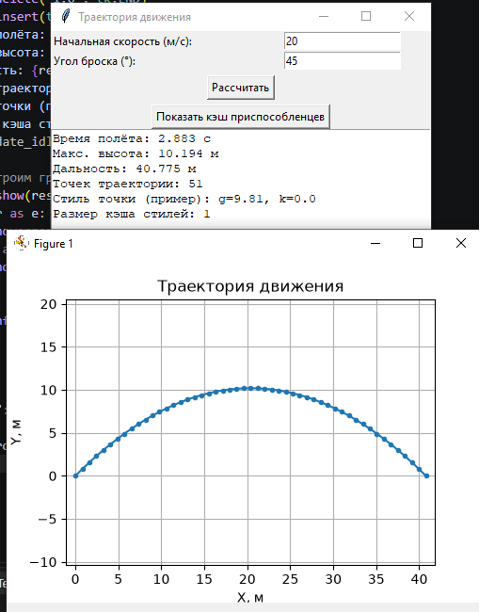
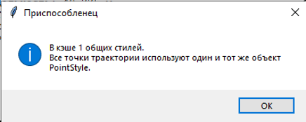

# Лабораторная работа №5 — Структурные паттерны: Фасад, Приспособленец

**Дисциплина:** Паттерны проектирования  
**Направление:** 09.03.04 «Программная инженерия»  
**Индивидуальный вариант:** 3 — Разработка приложения «Траектория движения»  
**Реализованные паттерны:** Фасад (Facade), Приспособленец (Flyweight)  
**Язык:** Python

## Цель работы

Изучить принцип работы структурных паттернов проектирования «Фасад» (Facade) и «Приспособленец» (Flyweight) и реализовать прикладную задачу расчёта траектории движения тела с использованием данных паттернов.

## Задача

Разработать приложение для расчёта параметров движения тела, брошенного под углом к горизонту, с использованием двух структурных паттернов проектирования.

## Описание паттернов

### 1. Фасад (Facade)
Паттерн предоставляет простой интерфейс к сложной системе классов, библиотеке или фреймворку. Фасад не запрещает обращаться к подсистеме напрямую, но предлагает удобную точку входа для типичных сценариев.

**Применение:** Подсистема расчёта состоит из классов `Validator` (проверка входных данных), `ModelCalculator` (расчёт модели) и `PlotBuilder` (построение графика). Класс `TrajectoryFacade` объединяет их в один метод `calculate_and_show(v0, angle)`, который выполняет всю цепочку действий. Клиентскому коду достаточно вызвать один метод фасада.

### 2. Приспособленец (Flyweight)
Паттерн позволяет экономить память, разделяя общее состояние между множеством объектов. Внутреннее состояние (общее для всех) хранится в одном экземпляре, а внешнее (уникальное) передаётся извне.

**Применение:** Точки траектории (`TrajectoryPoint`) содержат координаты `(x, y)` — внешнее состояние. Общие параметры расчёта (g, k, шаг) вынесены в класс `PointStyle` (внутреннее состояние). `PointFactory` создаёт и кэширует общие стили, чтобы при построении сотен точек общее состояние создавалось один раз.

## Структура приложения

| Компонент | Назначение |
| :--- | :--- |
| `Validator` | Проверка входных данных (подсистема Фасада) |
| `ModelCalculator` | Расчёт параметров движения (подсистема Фасада) |
| `PlotBuilder` | Построение графика (подсистема Фасада) |
| `TrajectoryFacade` | Единый интерфейс к подсистеме (Фасад) |
| `PointStyle` | Общее (внутреннее) состояние точек (Приспособленец) |
| `TrajectoryPoint` | Точка траектории с внешним состоянием |
| `PointFactory` | Фабрика и кэш общих стилей (Приспособленец) |
| `TrajectoryApp` | Графический интерфейс приложения |

## Примеры работы

Вход: `v0 = 20 м/с`, `угол = 45°`

**Расчёт траектории через фасад:**

**Окно «Показать кэш приспособленцев»:**

## Исходный код

См. [`main.py`](./main.py).
