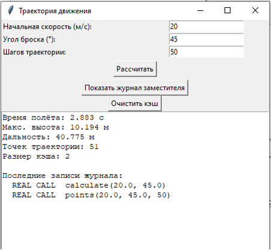
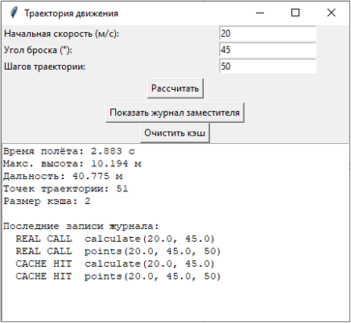
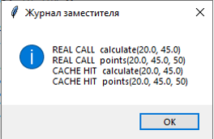
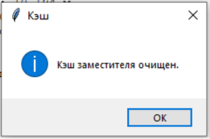

# Лабораторная работа №6 — Структурные паттерны: Заместитель

**Дисциплина:** Паттерны проектирования  
**Направление:** 09.03.04 «Программная инженерия»  
**Индивидуальный вариант:** 3 — Разработка приложения «Траектория движения»  
**Реализованный паттерн:** Заместитель (Proxy)  
**Язык:** Python

## Цель работы

Изучить принцип работы структурного паттерна проектирования «Заместитель» и реализовать прикладную задачу расчёта траектории движения тела с использованием данного паттерна.

## Задача

Разработать приложение для расчёта параметров движения тела, брошенного под углом к горизонту, с использованием структурного паттерна проектирования «Заместитель».

## Описание паттерна «Заместитель»

Заместитель — это структурный паттерн проектирования, который предоставляет объект-заменитель, контролирующий доступ к другому объекту. Заместитель имеет тот же интерфейс, что и реальный объект, поэтому клиентский код не замечает подмены.

**Применение:** Интерфейс `TrajectoryService` задаёт методы `calculate(v0, angle)` и `points(v0, angle, steps)`. Реальный объект `RealTrajectoryService` выполняет расчёт. Заместитель `TrajectoryProxy` реализует тот же интерфейс, но:
- создаёт реальный объект только при первом обращении (виртуальный заместитель);
- кэширует результаты по ключу `(v0, angle)` (кэширующий заместитель);
- записывает в журнал каждое обращение — попадание в кэш или реальный расчёт (логирующий заместитель).

## Структура приложения

| Компонент | Назначение |
| :--- | :--- |
| `TrajectoryService` | Общий интерфейс сервиса расчёта |
| `RealTrajectoryService` | Реальный объект — выполняет расчёт |
| `TrajectoryProxy` | Заместитель — кэширует, логирует, лениво создаёт реальный объект |
| `TrajectoryApp` | Графический интерфейс приложения |

## Примеры работы

Вход: `v0 = 20 м/с`, `угол = 45°`, `шагов = 50`

**Первый расчёт (реальный вызов):**

**Повторный расчёт с теми же параметрами (попадание в кэш):**

**Окно «Показать журнал заместителя»:**

**Окно «Очистить кэш»:**

## Исходный код

См. [`main.py`](./main.py).
