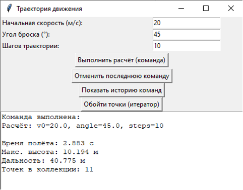
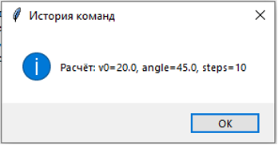
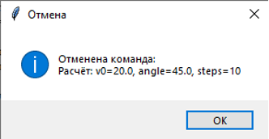
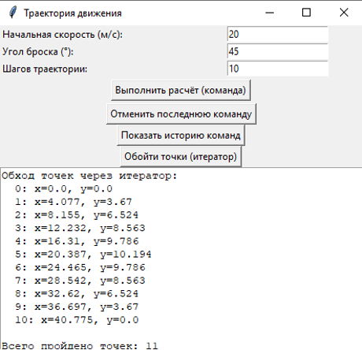

# Лабораторная работа №7 — Поведенческие паттерны: Команда, Итератор

**Дисциплина:** Паттерны проектирования  
**Направление:** 09.03.04 «Программная инженерия»  
**Индивидуальный вариант:** 3 — Разработка приложения «Траектория движения»  
**Реализованные паттерны:** Команда (Command), Итератор (Iterator)  
**Язык:** Python

## Цель работы

Изучить принцип работы поведенческих паттернов проектирования «Команда» и «Итератор» и реализовать прикладную задачу расчёта траектории движения тела с использованием данных паттернов.

## Задача

Разработать приложение для расчёта параметров движения тела, брошенного под углом к горизонту, с использованием двух поведенческих паттернов проектирования.

## Описание паттернов

### 1. Команда (Command)
Паттерн инкапсулирует запрос в виде объекта, позволяя параметризовать клиентов с запросами, ставить их в очередь, логировать и поддерживать отмену операций.

**Применение:** Интерфейс `Command` задаёт методы `execute()`, `undo()` и `description()`. Класс `CalculateTrajectoryCommand` инкапсулирует запрос на расчёт с параметрами `v0`, `angle`, `steps` и получателем — сервисом `TrajectoryService`. Класс `CommandHistory` хранит выполненные команды, позволяя отменить последнюю и просмотреть журнал.

### 2. Итератор (Iterator)
Паттерн предоставляет способ последовательного доступа к элементам составного объекта, не раскрывая его внутреннего представления.

**Применение:** Коллекция `TrajectoryCollection` хранит точки траектории. Итератор `TrajectoryIterator` обеспечивает последовательный обход точек, скрывая внутренний список от клиента. Клиентский код получает точки через методы `next()` и `has_next()`.

## Структура приложения

| Компонент | Назначение |
| :--- | :--- |
| `Command` | Общий интерфейс команды |
| `CalculateTrajectoryCommand` | Команда расчёта траектории |
| `CommandHistory` | История выполненных команд |
| `TrajectoryCollection` | Коллекция точек траектории (Итератор) |
| `TrajectoryIterator` | Итератор для обхода точек |
| `TrajectoryApp` | Графический интерфейс приложения |

## Примеры работы

Вход: `v0 = 20 м/с`, `угол = 45°`, `шагов = 10`

**Выполнение команды расчёта:**

**История команд:**

**Отмена последней команды:**

**Обход точек через итератор:**

## Исходный код

См. [`main.py`](./main.py).
